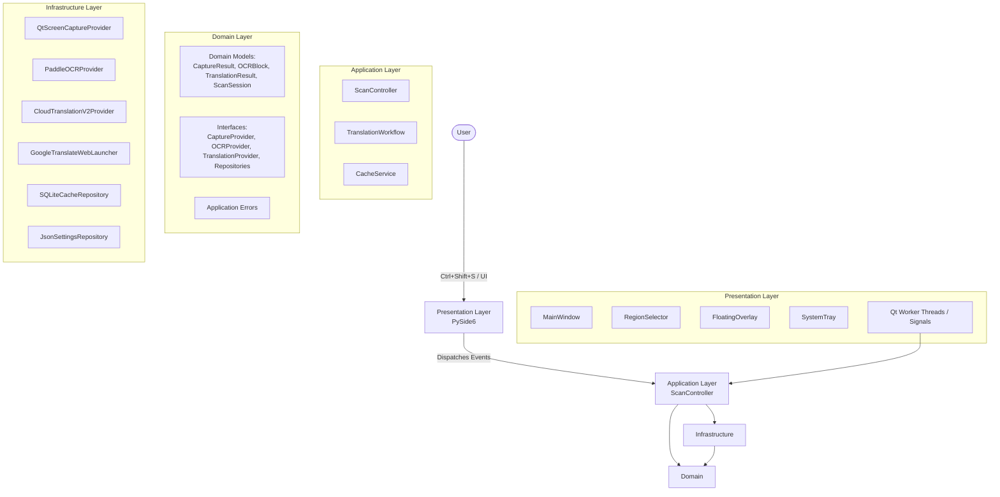

# ScanWitMe Architecture

This document outlines the architectural design and structural patterns for **ScanWitMe**.

## Layer Responsibilities

### 1. Domain Layer (`scanwitme.domain`)
Contains the core business models, custom exception hierarchies, and abstract provider interfaces.
- **Models**:
  - `CaptureResult`: Raw image data (bytes/PIL/QImage), screen geometry, timestamp.
  - `OCRBlock`: Extracted text, bounding box coordinates `[x1, y1, x2, y2]`, recognition confidence score, sort order.
  - `TranslationResult`: Source text, translated text, detected/configured source language, target language, provider identifier, latency metrics.
  - `ScanSession`: Unique session ID, state (`idle`, `capturing`, `recognizing`, `translating`, `completed`, `error`, `cancelled`), timestamps.
- **Interfaces**:
  - `CaptureProvider`: Asynchronously or synchronously captures a defined rectangular screen region.
  - `OCRProvider`: Accepts image input, outputs sorted `list[OCRBlock]`.
  - `TranslationProvider`: Accepts text and language parameters, returns `TranslationResult`.
  - `SettingsRepository`: Persists and retrieves user configuration.
  - `CacheRepository`: Persists and retrieves translation results keyed by normalized hash.
- **Exceptions**:
  - `ScanWitMeError` (Base)
  - `CaptureError`, `CaptureCancelled`
  - `OCRError`, `OCRNoTextFound`
  - `TranslationError`, `AuthenticationError`, `QuotaExceededError`, `NetworkError`

### 2. Application Layer (`scanwitme.application`)
Orchestrates domain workflows and ensures strict separation between GUI controls and background adapters.
- `ScanController`: Manages state machine, active session lifecycle, concurrency control (rejecting overlapping triggers or handling deterministically), and timing telemetry.
- `TranslationWorkflow`: Coordinates OCR block grouping/merging, cache lookups, provider selection, and fallback logic.
- `CacheService`: Normalizes source text (whitespace stripping, punctuation normalization), computes deterministic cache keys, and handles cache read/write operations.

### 3. Infrastructure Layer (`scanwitme.infrastructure`)
Concrete implementations of domain interfaces.
- `capture`: `QtScreenCaptureProvider` utilizes Qt screen capturing with High-DPI scaling factor conversion.
- `ocr`: `PaddleOCRProvider` wraps local PaddleOCR inference with lazy initialization, Korean and Chinese dictionary loading, and reading order heuristics.
- `translation`:
  - `CloudTranslationV2Provider`: Google Cloud Translation Basic v2 HTTP client with timeouts, retry backoff, and error mapping.
  - `GoogleTranslateWebLauncher`: Opens system default browser with URL-encoded query parameters.
- `cache`: `SQLiteCacheRepository` with WAL mode and indexed normalized hash lookups.
- `settings`: `JsonSettingsRepository` storing user preferences in OS-standard AppData directory.

### 4. Presentation Layer (`scanwitme.presentation`)
PySide6 user interface.
- Threading model: All heavy processing (screen capture, OCR, network translation) runs inside worker threads (`QRunnable` or `QThread`). Communication back to UI widgets occurs exclusively via Qt signals and slots.
- Overlay: Movable, frameless, always-on-top window that does not steal focus unnecessarily, providing instant copy, search, retry, and dismiss actions.
